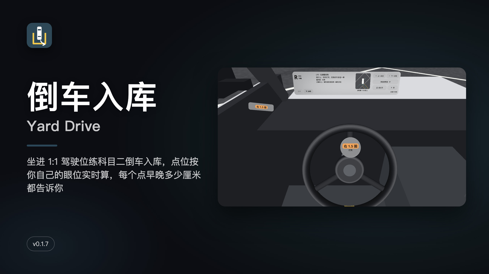
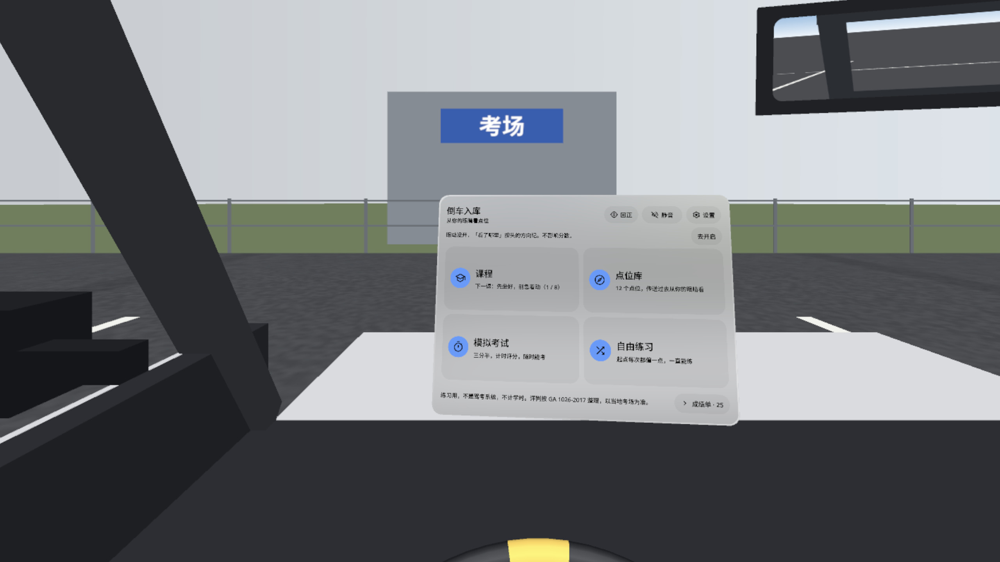
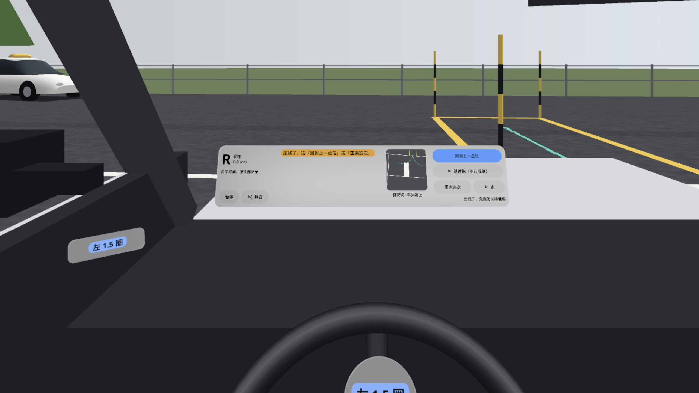
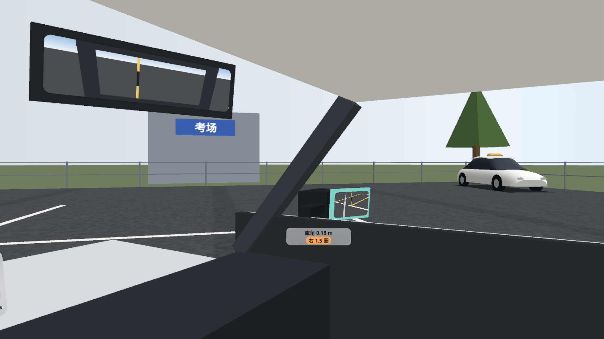
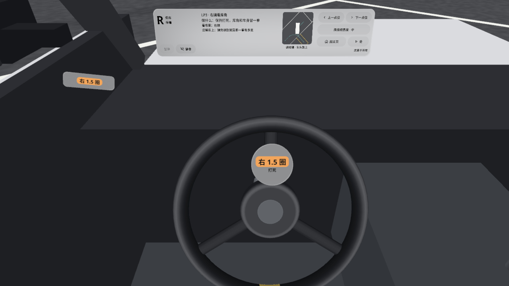
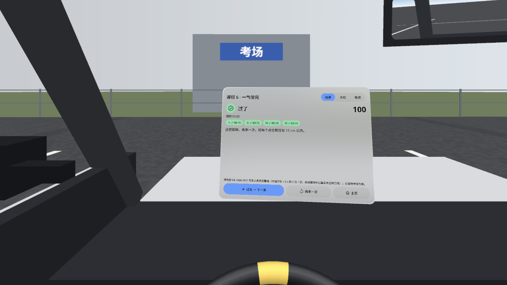
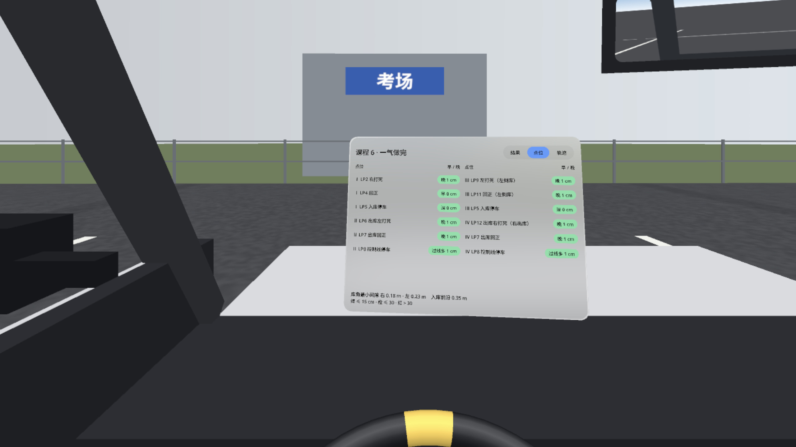
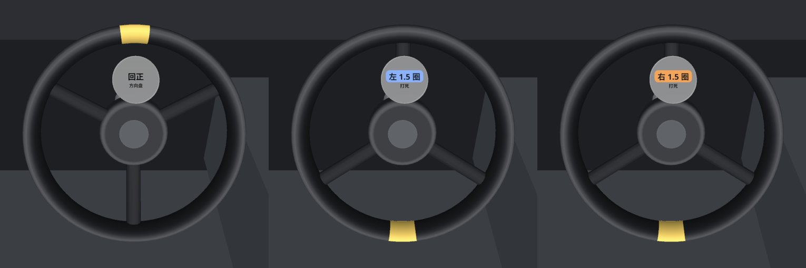

# 倒车入库 Yard Drive



**中文** · [English](#english)

坐进一辆 1:1 的考试车里练科目二倒车入库。点 P2 面板上的按键（或用手柄）把方向盘打死、回正，转头看左右后视镜和后窗。点位不是口诀，是从你自己的眼睛看出去的几何：按你的座椅高度和眼位实时算，每个点位告诉你打早 / 打晚了多少厘米。

- 8 节课由简到难：先坐好看四面 → 打方向看圈数 → 看右镜留一拳 → 出库别压库角 → 换方向 → 一气做完 → 不看提示 → 考一次
- 点位库：12 个关键点位，逐个看做什么、看哪里、看到什么
- 模拟考试：右倒库 → 左出库 → 左倒库 → 右出库，按 GA 1026-2017 判压线、未入库、中途停车、超时
- 自由练习：五把一组，默认宽松规则，也能挑难度
- 压线后可以回到上一点位、继续练（不计成绩）或重来这次；结果卡能看轨迹和回放
- 后视镜是等效曲面镜，镜子里是库线和你自己的车身；起步停车都是缓的，转弯加暗角，减轻晕车
- 中英双语，全部本机运行，不联网、不需要账号

PICO OS 6 · PICO Spatial SDK 6.1.9 · Kotlin · 全舞台（STAGE_FULL）· 包名 `io.embodit.yarddrive` · v0.1.7（versionCode 8）

### 截图（模拟器，中文界面）

| | |
|---|---|
|  主页：课程、点位库、模拟考试、自由练习 |  倒车压线：三个选择，方向盘读数「左 1.5 圈」 |
|  转头看右后视镜：库角线和自己的车身 |  点位库 LP3「右镜看库角」，方向盘打死右 1.5 圈 |
|  课程 6 一气做完，四段全过 100 分 |  成绩单「点位」页：每个点打早 / 打晚多少厘米 |

方向盘：回正 / 打死左 1.5 圈 / 打死右 1.5 圈



### 安装

Release 里的 `YardDrive-v0.1.7.apk` 是 `assembleRelease` 出的**未签名**包（给平台重签名用），直接 `adb install` 会被拒。自己侧载先用 debug key 签名：

```bash
apksigner sign --ks ~/.android/debug.keystore --ks-pass pass:android --out YardDrive-v0.1.7-debugsigned.apk YardDrive-v0.1.7.apk
adb install -r YardDrive-v0.1.7-debugsigned.apk
pico-cli app launch io.embodit.yarddrive
```

或者自己构建：`./gradlew assembleDebug` → `adb install -r app/build/outputs/apk/debug/app-debug.apk`。

### 演示视频

Release 附件 `YardDrive-demo.mp4`（v0.1.7，60 s，英文界面，无声）：在 PICO 模拟器上用 `adb input tap` 真实点按录的，**非真实手势录像**。

### 已知问题

- 挡把杆底离中控台面约 5 cm 悬空（`CarModel.kt:37 / 49`、`Smooth.kt:326`），下一版修
- 压线时第 2 列那句提示「回到上一点位或重来这次」没提第三个键「继续练（不计成绩）」
- 教练车近看（6–7 m）车顶浅色顶板边缘略探出车窗一圈；15–30 m 外看不出
- debug 包的调试广播接收器在模拟器极低帧率时出过一次 ANR（发布包没有这个接收器）
- 研发工具 `tools/real_drive.py` 在模拟器 1 fps 时跑不通（工具问题，不影响应用）
- QA 第 7 轮记的小问题这轮没复查：中文字体子集缺「或」「局」、自由练习 P2「俯视镜已关」、步进 0.15 s 线性坡、认线课两个「暂停」、英文「1 times」单复数
- 还没在头显上验证：晕不晕、暗角、真实帧率、手柄按键、真开进库、听感、方向盘近看、真机光照下挡把和教练车会不会发黑

---

<a id="english"></a>
## English

Sit in a 1:1 exam car and practise the bay park of the Chinese driving test (科目二倒车入库). Tap the P2 keys (or use the controller) to steer to full lock and back, and turn your head to the mirrors and the rear window. The reference points are not a chant: they are computed live from your own seat height and eye position, and every point tells you how many centimetres early or late you were.

- 8 lessons from easy to hard, ending with a full test
- Look-point library: 12 key points, each with what to do, where to look and what you should see
- Mock test: reverse in right → pull out left → reverse in left → pull out right, judged to GA 1026-2017 (line touched, not in the bay, stop > 2 s, time-out)
- Free practice: runs of 5, easy rules by default
- After touching a line: back to last point, carry on (unscored) or restart; results show the track and a replay
- Equivalent curved mirrors showing the bay lines and your own car; gentle starts and stops, vignette in turns
- Chinese and English, fully offline, no account

**Install**: the release APK is unsigned (for platform re-signing). Sign it with your debug key first (see the `apksigner` command above), then `adb install -r <apk>` and `pico-cli app launch io.embodit.yarddrive`.

**Demo video**: `YardDrive-demo.mp4` in the release, recorded on the PICO emulator with real `adb input tap` taps; **not a real hand-gesture recording**.

**Known issues**: gear-lever shaft floats ~5 cm above the console (next version); the line-touched hint does not mention the third key "Carry on (unscored)"; the coach cars' roof panel overhangs slightly at 6–7 m; small QA round-7 items not re-checked; not yet verified on a headset.

Fonts: Noto Sans / Noto Sans SC, SIL OFL 1.1 (`third_party/`).
